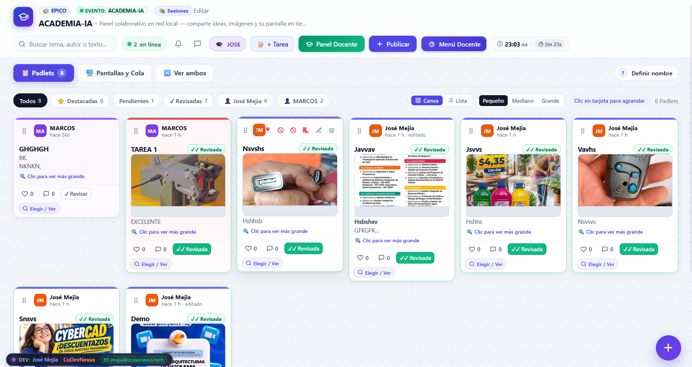
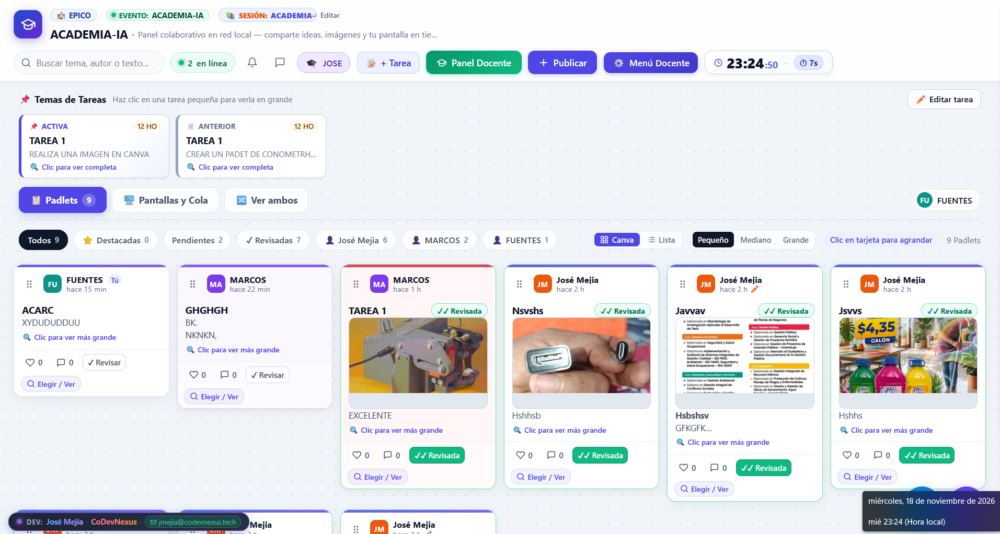
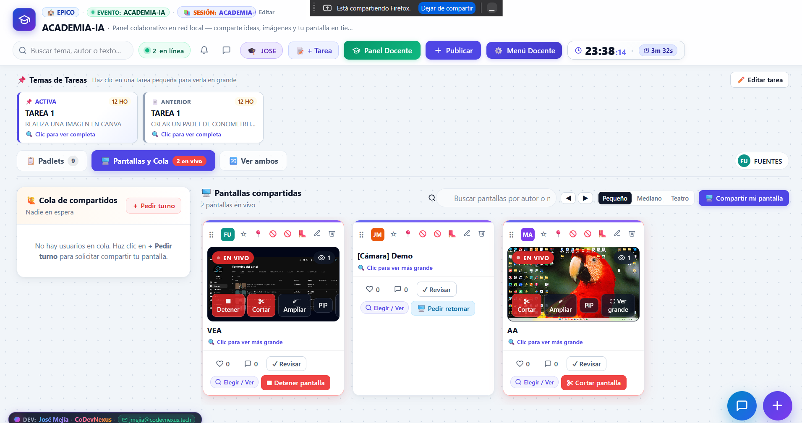
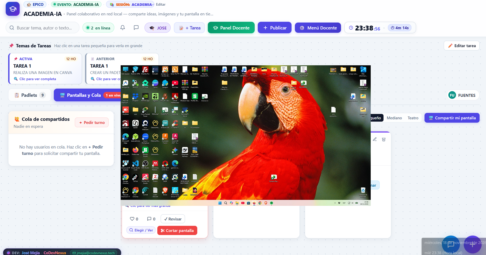

# PadletLocal ⚡

> **Pizarra colaborativa interactiva, transmisión de pantalla y evaluaciones en tiempo real para red local (LAN).**  
> **Diseñado para cursos privados, aulas de formación, talleres y clases presenciales.**  
> **100% Privado · Soberanía de Datos · Funciona sin Conexión a Internet**

Desarrollado por **[CoDevNexus](https://www.codevnexus.tech)**.

---

## 📖 ¿Qué es PadletLocal?

**PadletLocal** es una plataforma tipo Padlet pensada para docentes, capacitadores y alumnos que necesitan interactuar, compartir ideas, proyectar pantallas y realizar evaluaciones en vivo dentro de una misma red local (Wi-Fi o cable Ethernet), **sin que la información salga a internet ni dependa de servidores externos en la nube**.

Todos los textos, preguntas, tareas, imágenes y respuestas quedan almacenados de manera segura exclusivamente en la computadora del profesor.

---

## 📸 Galería y Capturas de Pantalla del Sistema

A continuación puedes apreciar la interfaz moderna e interactiva de **PadletLocal** en acción:

<div align="center">

### 📋 1. Pizarra Colaborativa en Tiempo Real y Tareas
*Publicaciones organizadas con autor, temas, badges oficiales del profesor, reloj ampliado de clase y buscador instantáneo.*  


<br/>

### 🖥️ 2. Transmisión de Pantalla en Vivo (WebRTC) y Cola de Turnos
*Espacio de transmisión directa en red local con prioridad docente, orden de pantallas y re-encolado ágil para alumnos.*  


<br/>

### 💬 3. Chat Interactivo en Vivo de la Sesión
*Drawer lateral flotante que no bloquea la navegación en el tablero, con mensajes públicos, privados y alertas sonoras.*  


<br/>

### 🧠 4. Evaluaciones, Quizzes y Panel de Control
*Creación y control de evaluaciones en vivo, estadísticas de acierto para el profesor y gestión de participantes.*  


</div>

---

## 🚀 Guía de Inicio Rápido para el Usuario

### 1. Iniciar la plataforma en la computadora anfitriona (Profesor)

1. En la carpeta del programa, haz doble clic en el archivo:
   ```text
   PadletLocal.bat
   ```
2. Se abrirá el **Panel de Control interactivo**.
3. Selecciona la opción **`[1] Iniciar servidor`**. El sistema configurará los certificados locales y arrancará el servidor en segundo plano.
4. Selecciona la opción **`[4] Abrir PadletLocal en el navegador`** para ingresar inmediatamente a la pizarra.

---

### 2. ¿Cómo se conectan los alumnos?

1. Los alumnos y participantes deben estar conectados al **mismo Wi-Fi o red local** que la computadora principal.
2. El profesor comparte el enlace que aparece en pantalla (por ejemplo: `https://192.168.1.50:3443`) o muestra el **código QR** desde el botón **Red local** en la barra superior.
3. Los alumnos abren el enlace desde su navegador en laptop, tablet o teléfono celular.

---

### 3. Quitar la advertencia / pantalla roja (1 solo clic en Windows)

Al usar certificados de seguridad locales sin internet, los navegadores muestran una advertencia inicial de seguridad. Para quitarla de forma definitiva:

- **En Windows:** Los alumnos pueden descargar y ejecutar el archivo:
  ```text
  http://<IP-DEL-PROFESOR>:3000/cert/Instalar-Certificado-Windows.bat
  ```
  Hacen doble clic, pulsan **Sí** y la página se abrirá con **candado seguro verde/gris sin pantallas rojas**.
- **En otros dispositivos o sin instalar:** En la pantalla de aviso del navegador, pulsar **"Configuración avanzada"** y luego **"Continuar al sitio (no seguro)"**.

---

## 🎯 Funcionalidades Principales para el Aula

### 🎬 Modo Demostración Integrado (Para Reels, YouTube y Marketing)
- **Generador de Sesión Demo en 1 Clic:** Crea instantáneamente una sesión enriquecida y lista para grabar videos promocionales, reels o tutoriales en YouTube (`🎬 Sesión Demo · Academia IA 2026`).
- **Contenido precargado de alto impacto:** Incluye logotipo institucional vectorizado, consigna de clase fijada, post docente destacado con comentarios, entrega de alumno con **gráfico vectorial de precisión y matriz de confusión SVG 100% offline**, código YOLOv8 y consultas de programación resueltas.
- **Interacción simulada:** Precarga 10 mensajes de chat en vivo y alumnos ficticios en la cola de pantalla compartida.
- **Regla de integridad y orden:** Solo se permite **una sola sesión demo a la vez**. Para generar una nueva demostración, el sistema solicita eliminar la anterior con confirmación segura.

### 📱 Acceso con Deslizamiento Táctil / Slider Horizontal (Alumno Primero)
- **Diseño enfocado de una sola vista:** Muestra un único formulario en pantalla a la vez para eliminar la sobrecarga cognitiva en los participantes.
- **Navegación por deslizamiento (Swipe):** Permite cambiar entre el rol de **Alumno** y **Docente** deslizando horizontalmente con el dedo en pantallas táctiles o móviles, o haciendo clic en el selector segmentado y flechas de navegación en computadoras.
- **Prioridad fija para Alumnos:** Al abrir el diálogo de bienvenida o recargar la página, el formulario de **Alumno se muestra siempre en primer lugar** de forma predeterminada.
- **Inicio de sesión directo:** Cada formulario cuenta con validación instantánea y botón de acceso específico para su rol.

### 🪟 Ventanas Flotantes Pop-Out (`🪟 Flotante` para Pantallas Inalámbricas y Monitores Extendidos)
- **Separación de pantalla con 1 clic:** Cualquier transmisión de pantalla WebRTC o publicación de la pizarra cuenta con el botón **`🪟 Flotante`**.
- **Ideal para proyección múltiple:** Permite desacoplar una pantalla a una ventana flotante sin bordes del navegador para arrastrarla a proyectores HDMI, televisores o pantallas inalámbricas (Miracast, Chromecast, AirPlay).
- **Retorno instantáneo:** Al cerrar la ventana externa o presionar **`↩ Regresar`**, la pantalla o tarjeta regresa automáticamente al flujo del tablero sin interrupciones.

### 💬 Chat Interactivo en Vivo con Canales Privados y Notificaciones Inteligentes
- **Hilos públicos y privados:** Permite comunicación grupal para toda la clase o conversaciones privadas individuales entre docente y alumno o entre compañeros, manteniendo privacidad total en red local.
- **Lista de participantes conectados:** Muestra en tiempo real qué usuarios están en línea con acceso rápido para iniciar un chat privado.
- **Badges de mensajes no leídos:** Indicador numérico visual en rojo con el total de mensajes pendientes por leer.
- **Silenciador selectivo:** Control para silenciar alertas de sonido globalmente o para un hilo privado específico.
- **Multimedia y personalización:** Soporte para adjuntar imágenes/fotos en el chat, selector de emojis y cambio de apodo (nick) persistente.

### 📋 Pizarra de Padlets
- **Escribir aportes:** Publica respuestas con tu nombre, tema, texto y fotos adjuntas.
- **Pegar imágenes directo:** Puedes arrastrar archivos de imagen o pegar capturas de pantalla directamente con **`Ctrl + V`**.
- **Mover respuestas arrastrándolas (Drag & Drop):** Toma cualquier tarjeta desde el icono **`⠿`** y muévela a otra posición de la pizarra para organizar las ideas.
- **Destacar respuestas (`⭐`):** Marca las mejores intervenciones con una estrella para resaltarlas con marco dorado, y usa el filtro **`⭐ Destacadas`** para verlas todas juntas.
- **Visto de revisión (`✓✓ Revisada`):** El profesor puede marcar qué respuestas ya fueron revisadas para llevar el control visual de la clase.
- **Visualización inteligente:** Cuando hay muchas respuestas, el tablero se adapta a formato compacto; al hacer clic en cualquier tarjeta pequeña, esta crece para leerla con comodidad con vista previa en modal ampliado.

### 🖥️ Transmisión de Pantalla en Vivo (WebRTC)
- **Pestaña separada:** Las pantallas compartidas tienen su propia sección (**Pantallas y Cola**) para no saturar la pizarra de texto.
- **Sencillo y directo:** Para compartir pantalla solo se pide **Nombre** y **Motivo**.
- **Cola de turnos y re-encolado:** Los alumnos pueden pedir turno para exponer de forma ordenada y volver a encolar su pantalla si el docente ya revisó su trabajo inicial.
- **Prioridad inteligente:** La pantalla del profesor siempre se posiciona en primer lugar con distintivo oficial de docente.
- **Control docente:** El profesor puede pausar/cortar temporalmente una pantalla (`✂ Cortar`) o retomarla en cualquier momento (`▶ Retomar`).

### 🧠 Evaluaciones y Quizzes con Análisis de Entendimiento
- **Tests con tiempo:** Preguntas de opción múltiple con cuenta regresiva individual (10s a 120s).
- **Control de publicación:** El docente puede preparar los exámenes previamente y publicarlos cuando llegue el momento.
- **Porcentaje de entendimiento:** Gráficos automáticos que revelan el porcentaje global de acierto, respuestas por alumno y qué temas requieren refuerzo.
- **Duplicar entre clases:** Permite copiar cuestionarios de una sesión a otra en 1 clic.

### 📝 Temas de Tareas y Temporizadores Docentes
- **Consignas fijadas:** Instrucciones de trabajo en la parte superior que crecen al hacer clic.
- **Reloj ampliado y temporizadores sincronizados:** Reloj de cabecera de doble línea de alta visibilidad, descansos programados (5, 10, 15+ min) y **modo proyector (pantalla completa)** para el aula.
- **Avisos y notificaciones modernas:** Integración con alertas modernas tipo SweetAlert2 funcionando **100% offline** sin internet.

### 🏫 Marca Institucional Adaptativa
- **Soporte de logotipos:** Permite cargar insignias o logos cuadrados (`1:1`) o panorámicos/rectangulares (`wide`), adaptando automáticamente la cabecera sin recortes.
- **Configuración de evento:** Permite personalizar el nombre de la institución, título del evento y descripción de la sesión.

### 🌱 Modo Fácil vs ⚡ Modo Completo
- **Modo Fácil (`🌱`):** Pensado para personas con poca afinidad tecnológica. Botones grandes, claros y sin opciones complejas.
- **Modo Completo (`⚡`):** Pensado para usuarios avanzados con filtros, buscador, atajos de teclado y vista combinada.

### 📚 Múltiples Sesiones de Clase
- Permite crear diferentes sesiones o grupos en un mismo día (ej. *Clase Mañana*, *Grupo Tarde*).
- Los alumnos solo ven y entran a las clases que el profesor habilite.

---

## 🔄 Cómo Actualizar la Aplicación sin Perder tus Datos

PadletLocal está diseñado para que **nunca pierdas tus clases, preguntas, tareas ni fotos**:

1. Cierra el servidor si está activo.
2. Abre **`PadletLocal.bat`**.
3. Elige la opción **`[9] Buscar y aplicar actualizaciones (Git / Backup Seguro)`**.
4. El asistente creará automáticamente una copia de respaldo de todas tus publicaciones en `data/backups/` y descargará las mejoras del sistema de forma segura.

---

## 💻 Requisitos del Sistema

- **Computadora anfitriona (Servidor):** Windows 10/11, Windows Server, Linux o macOS con [Node.js](https://nodejs.org/) (versión 18 o superior).
- **Dispositivos participantes:** Cualquier computadora, tablet o smartphone con navegador web moderno (Chrome, Edge, Safari, Firefox).
- **Red:** Conexión a red local (Wi-Fi o cable de red). **No requiere conexión a internet.**

---

## 📜 Licencia y Términos de Uso

**Copyright (c) 2026 CoDevNexus (Código + Desarrollo + Unión)**  
Contacto para licencias comerciales: [jmejia@codevnexus.tech](mailto:jmejia@codevnexus.tech) · [www.codevnexus.tech](https://www.codevnexus.tech)

Este software se distribuye bajo un **modelo de licenciamiento dual**:

1. **Uso Gratuito, Educativo y Clases sin Costo (No Comercial):**  
   Distribuido bajo la licencia **[PolyForm Noncommercial 1.0.0](https://polyformproject.org/licenses/noncommercial/1.0.0/)**.  
   Es 100% gratuito para uso personal, investigación y educación sin fines de lucro.
   > **★ Fomento a Clases Gratuitas:**  
   > Se autoriza expresamente y se fomenta el uso totalmente gratuito de PadletLocal para impartir **clases gratuitas, talleres comunitarios, voluntariado o capacitaciones sociales a personas**, siempre que **NO se cobre matrícula, cuota ni arancel a los alumnos**.

2. **Uso Comercial e Instituciones Privadas (De Pago):**  
   Queda prohibido vender este software, ofrecerlo como servicio de pago, o utilizarlo dentro de academias, colegios, universidades o cursos privados donde se cobre matrícula o aranceles a los estudiantes, sin haber adquirido previamente una **Licencia Comercial escrita** emitida por **CoDevNexus**.

---

## 🏢 Sobre CoDevNexus

**CoDevNexus** (*Código + Desarrollo + Unión*) es una firma especializada en ingeniería de software y arquitectura tecnológica. Nos dedicamos a crear ecosistemas digitales robustos, integrando desarrollo Full-Stack, infraestructura de servidores, redes empresariales, sistemas de seguridad electrónica e IoT. Transformamos necesidades operativas complejas en herramientas eficientes, escalables y seguras.

- **Sitio Web Oficial:** [www.codevnexus.tech](https://www.codevnexus.tech)
- **Soporte Técnico y Consultas:** [jmejia@codevnexus.tech](mailto:jmejia@codevnexus.tech)
